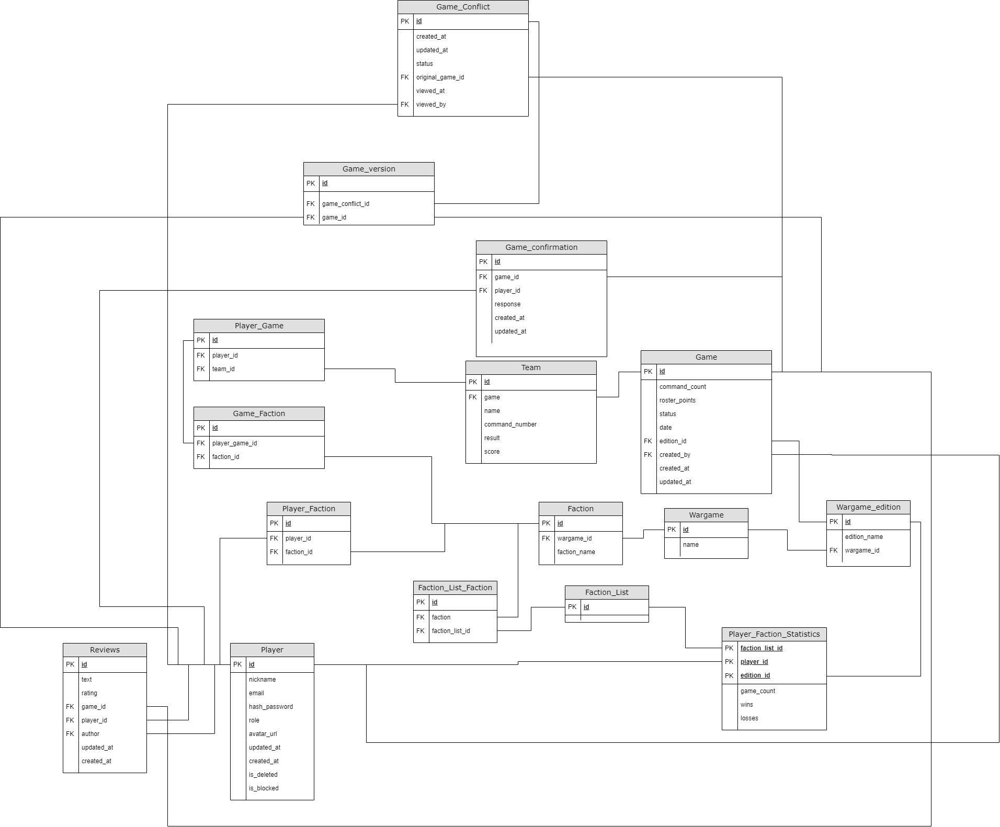

# Wargame Stats

Информационная система для сбора и визуализации статистики настольных варгеймов.

---

## Цель проекта

Разработанная информационная система предназначена для упрощения сбора статистики об игроках и проведённых партиях в настольные военные игры (далее – варгеймы) в пределах одного города.

Создание единой базы данных способствует популяризации хобби и большему единению участников сообщества. У пользователей появляется возможность видеть, как много людей играет в различные системы, просматривать статистику фракций и выбирать оппонентов по их рейтингу и отзывам.

---

## Функциональные возможности

Система предоставляет разный набор возможностей в зависимости от роли пользователя.

### Гостям и всем посетителям

Даже без авторизации на сайте доступны основные блоки статистики:

1. **Рейтинг популярности варгеймов.** Показывает, сколько партий было сыграно в различные системы за последнее время.
2. **Рейтинг фракций.** Демонстрирует, как часто участники одерживают победы за определённую сторону в выбранном варгейме.
3. **Список игроков.** Содержит рейтинг, сформированный на основе отзывов других участников сообщества, и ссылки на личные кабинеты. В профиле можно узнать, в какие системы играет человек и какие фракции собирает.

### Авторизованным пользователям

Помимо просмотра статистики, открывается возможность регистрировать партии. Партия становится официальной и попадает в общую статистику только после того, как её подтвердят все участники.

### Модераторам

Модераторы – это доверенные игроки сообщества. Им предоставляется доступ к разрешению спорных моментов в регистрируемых партиях и контролю за соблюдением правил со стороны обычных пользователей.

### Администраторам

Администраторы назначаются владельцем сайта для управления учётными записями. В их задачи входит:

* назначение модераторов из числа обычных пользователей;
* временная блокировка возможности регистрировать партии;
* удаление пользователей из системы.

## Архитектура проекта

### Общая структура

Приложение построено по принципу модульного монолита. Вся система разворачивается и работает как единое целое, однако её внутренняя логика разделена на изолированные функциональные блоки. 

Для реализации этой идеи используются механизмы Blueprint из фреймворка Flask. Каждый Blueprint отвечает за строго определённую зону ответственности и группирует в себе связанные маршруты, шаблоны и вспомогательную логику. В проекте выделены следующие основные модули:

* `auth` – отвечает за регистрацию, аутентификацию, управление сессиями и проверку прав доступа.
* `profile` – формирует публичные страницы игроков, отображает их личную статистику, список игр и полученные отзывы.
* `games` – реализует логику создания новых партий, поиск оппонентов и общий список сыгранных матчей.
* `confirm` – управляет процессом подтверждения партий участниками, включая механизм оспаривания результатов и создание альтернативных версий.
* `moderation` – предоставляет интерфейс для модераторов, включающий разрешение спорных ситуаций и финализацию партий.
* `admin` – содержит инструменты для администраторов по управлению учётными записями пользователей.
* `statistics` – отвечает за сбор, агрегацию и визуализацию данных для статистики.

### Слои внутри приложения

Внутри каждого модуля код разделён на слои, для упрощения поддержки.

* **Модели данных.** Описывают структуру базы данных через SQLAlchemy и отвечают за целостность связей на уровне ORM.
* **Маршруты.** Принимают запросы, проверяют права доступа и выступают диспетчерами, передавая управление сервисам и шаблонам.
* **Сервисы.** Содержат основную бизнес-логику, включая создание партий, проверку результатов и финализацию игр.
* **Шаблоны.** Отвечают за визуализацию на базе Jinja2.

### Схема базы данных

Основные сущности и связи между ними представлены на диаграмме ниже:

## Используемые технологии

**Python 3 и Flask**

Язык Python и микрофреймворк Flask составляют основу серверной части приложения.

В рамках проекта Flask используется для обработки входящих HTTP-запросов, маршрутизации и управления жизненным циклом запроса. Механизм контекстов позволяет сохранять данные о текущем пользователе на протяжении всей обработки запроса, что избавляет от необходимости передавать эту информацию явно через каждый слой приложения. Для организации структуры кода применены Blueprint, которые разделяют приложение на изолированные модули. Конфигурация и инициализация приложения выполняются централизованно при старте системы.

**Jinja2**

Визуализация данных реализована с использованием шаблонизатора Jinja2. Он позволяет динамически формировать HTML-страницы на основе данных, переданных из маршрутов. Шаблонизатор поддерживает циклы, условия и фильтры, что упрощает вывод повторяющихся элементов интерфейса и делает код шаблонов более компактным.

**SQLAlchemy и Flask-SQLAlchemy**

Взаимодействие с базой данных построено на ORM SQLAlchemy и расширении Flask-SQLAlchemy. Модели описаны в виде Python-классов, что позволяет работать с таблицами как с объектами и выполнять запросы без написания сырого SQL. На уровне моделей заданы связи между сущностями, а также правила каскадного удаления и ограничения целостности, что переносит часть контроля данных на уровень приложения. Flask-SQLAlchemy обеспечивает управление сессиями, автоматически отслеживает изменения объектов и синхронизирует их с базой данных при сохранении.

**Flask-Migrate**

Для управления изменениями схемы базы данных используется Flask-Migrate, работающий поверх Alembic. Он применяется для генерации и применения миграций при изменении структуры таблиц. В процессе разработки это позволяет безопасно обновлять структуру базы данных без потери существующих данных, а также откатываться к предыдущим версиям схемы при необходимости.

**PostgreSQL**

В качестве СУБД используется PostgreSQL. На уровне базы данных применяются внешние ключи и ограничения целостности для поддержания связей между таблицами.
